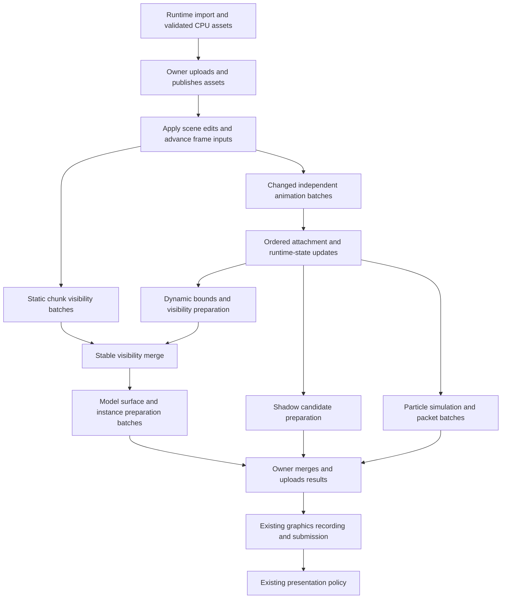

# Runtime conversion and parallel frame preparation

Status: **historical record**, archived 2026-10-23. This file preserves the
original results, limits and plans; its old status labels and checklists do not
define current work. See the [current renderer status and backlog](../../rendering-performance-overhaul.md).

## Recorded investigation

Status: first serial optimization retained; draw-refresh, direct-emission and ordered-surface trials rejected,
2026-10-22. **Tier 2.**
[Renderer status](../../rendering-performance-overhaul.md) ·
[Workloads](../../render-perf-workload-contract.md) ·
[Previous submission experiments](render-perf-draw-submission.md).

Keep runtime asset conversion and improve the existing renderer through small,
measurable changes to data access and CPU frame preparation. Reuse the common
in-memory asset representation and Taskflow executor implementation. Organize
work as explicit batch transforms with stable inputs, exclusive outputs and
dependencies that identify when results become usable.

The intended result is shorter complete-frame CPU latency with unchanged images,
simulation, editor behavior and submitted content. More worker activity by itself
is not success. Phase 0 is complete, and the first serial surface-preparation
change is retained: accumulate binding statistics during collection instead of
rescanning the completed rows. The six-pair large-overview result saves a median
paired 0.436 ms of host time (2.15% paired geometric reduction), with 27 exact
image comparisons and 201 passing tests. This is a serial gain; additional model
preparation threading is not implemented. Subsequent in-place draw-refresh,
direct-emission and ordered-surface trials failed their retention gates and were restored.
See the Phase 1 results below.

## Decisions and scope

1. Preserve runtime conversion for NWN and glTF. Retain the existing
   `ModelAsset -> RenderModel` boundary. Add no persistent compiled asset format,
   offline build database, dependency database or mandatory asset build step.
2. Preserve the current visible result. Keep simulation cadence, animation times,
   material interpretation, transparency order, shadow coverage and editor
   semantics. Introduce no approximation, population reduction or camera limit.
3. Use plain C-style C++ batch functions, flat records, arrays, indices and explicit
   ownership. Follow AGENTS.md and the existing clang-format configuration.
4. Reduce repeated work before distributing the remaining work. Preserve retained
   poses, static surface groups, sort reuse and shared view constants.
5. Expand CPU parallelism through independent preparation batches. Keep resource
   mutation, graphics submission and presentation under their current owner in
   the first implementation. Parallel Vulkan recording is a separate experiment.
6. Design for integrated and discrete GPUs and different CPU topologies. Current
   performance evidence covers one Ryzen/Radeon system. Asset names, GPU model
   names and locally fitted thresholds must not become general renderer policy.
7. Reuse existing storage and dependencies. Add only the small execution adapter
   and workload-specific batch storage needed by a measured stage. Do not build a
   general engine scheduler, ECS, streaming system or GPU frame graph here.

Normal elevated gameplay with basic NWN content must reach at least 60 fps with
substantial additional headroom. Whole-area toolset overview targets 30 fps.
DA:I/Ryse describes the visual direction; neither existing fixtures nor this
plan establish final-art capacity. The exact additional headroom target remains
unset. CPU work, GPU work, displayed cadence and input-to-display latency remain
separate quantities.

## Framing and limits

The problem is repeated or serialized preparation of data consumed by rendering:
poses, transformed bounds, visibility, surface rows, shadow candidates and
instance payloads. The common steady case has stable assets/topology and changes
to camera, a subset of instances, animations and particles. Editing, loading and
resource invalidation change ownership less often and need explicit boundaries.

The first deliverable is one complete vertical slice: a measured CPU preparation
stage expressed as the same batch transform in serial and worker execution,
integrated into the actual frame, with exact output and a complete-frame gain.
Choose its stage from current attribution in Phase 0. Prefer substantial model
preparation work; do not select a trivial loop solely because it is easy to thread.

Stop expanding a candidate when scheduling, extra passes, copied data, memory
traffic or remaining serial work erase its complete-frame benefit. Plan B is the
existing serial batch path and retained particle parallelism. A locally rejected
candidate does not reject an architecture on all hardware.

## Patterns and conventions found

Line references below describe the inspected working tree on 2026-10-22,
HEAD `6b03d8c96213536982d33259c89deee27639cda5` plus existing uncommitted work.

| Existing code | Relevant behavior and reuse |
| --- | --- |
| [model_asset.hpp](../../../lib/nw/render/model_asset.hpp), lines 57–123 | CPU-owned primitives, material texture references, nodes, skins, clips and particles already form a common in-memory `ModelAsset`. |
| [model_asset.cpp](../../../lib/nw/render/model_asset.cpp), lines 796, 1086, 1144 onward | Asset validation, geometry upload and texture conversion/upload already have separate entry points; texture decoding and GPU upload are still interleaved internally. |
| [NWN importer](../../../lib/nw/render/nwn/model_loader.cpp), lines 935, 1000, 2853 | Runtime conversion exists, but material and texture-analysis caches are mutable function-static maps; resource-manager calls occur inside conversion. Treat these paths as owner-thread-only until separated or proven safe. |
| [glTF importer](../../../lib/nw/render/gltf/import_gltf.cpp), lines 1074, 1174 onward | CPU import produces `ModelAsset`, followed by geometry and material texture upload. It is an existing candidate boundary, not a thread-safety proof. |
| [RenderService](../../../lib/nw/render/render_service.hpp) and [implementation](../../../lib/nw/render/render_service.cpp), lines 59–87 | Existing service owns renderer backends/caches. Cache clear, shader reload and shutdown need to join borrowed work before releasing resources. |
| [preview_render_resources.hpp](../../../lib/nw/render/viewer/preview_render_resources.hpp), lines 44–51 | Weak references already share static models across overlapping scene replacements without extending model lifetime. Preserve this behavior. |
| [preview_scene.cpp](../../../lib/nw/render/viewer/preview_scene.cpp), lines 124–155, 1034–1106 | Scene-owned persistent Taskflow executor, batches of 64 particle systems, immediate join. Simulation and packet preparation both run inside each batch. |
| [model_instance_animation.hpp](../../../lib/nw/render/model_instance_animation.hpp) | Existing plural samplers and changed-input pose reuse. The current sample boundary contains borrowed instance/model pointers. |
| [model.hpp](../../../lib/nw/render/model.hpp), lines 470–505, 603 onward | Animation backend and scratch belong to each instance; the instance store is a vector of generation-checked records that can relocate on insertion. |
| [area_render_scene.hpp](../../../lib/nw/render/viewer/area_render_scene.hpp), lines 528 onward | Bounds, transforms, flags, indices and chunk offsets already occupy separate arrays. Reuse their access patterns. |
| [area_render_scene.cpp](../../../lib/nw/render/viewer/area_render_scene.cpp), line 3980 onward | Visibility currently mutates shared vectors, generation marks and statistics. Calling the whole function concurrently is not safe. Cached static draw lists are important fast paths. |
| [preview_model_draws.hpp](../../../lib/nw/render/viewer/preview_model_draws.hpp) and [model_draw.hpp](../../../lib/nw/render/model_draw.hpp), line 129 onward | CPU-only batches and index streams already exist. `PreparedModelSurfaceDraw` has an asserted size of 208 bytes; it is inappropriate as a universal hot-loop input. |
| [shadow_culling.hpp](../../../lib/nw/render/shadow_culling.hpp) | Existing plural transform from bounds and view matrices to ordered visibility bytes; explicit shape rejection and up to eight views. |
| [frame_storage_arena.hpp](../../../lib/nw/render/frame_storage_arena.hpp) | Existing mapped GPU storage allocator and bounds checks. Allocation and reset are mutable owner operations, not concurrent worker APIs. |
| [render CMake](../../../lib/nw/render/CMakeLists.txt), lines 9–29, 142–175 | Taskflow 4.1.0 is currently private to `nw-render-viewer`; `RenderService` is in `nw-render`. Moving executor ownership must preserve the library dependency direction. |

Existing code has classes, vectors and owning smart pointers. Converting those
wholesale would change loaders, caches, editors, animation and GPU lifetimes at
once. The smaller compliant change retains those cold owners and exposes flat,
indexed batch data at new hot boundaries. New inner loops do not introduce
virtual dispatch, shared ownership updates or per-record allocations.

## Observed inputs and platform

| Input | Observed shape or distribution | Change frequency |
| --- | --- | --- |
| NWN city fixture | 32×32: 1,680 models and 600 particle systems before the configured preview actor. Repetition yields 6,720/2,400 at 64 and 15,120/5,400 at 96. | Asset/topology stable during fixed replay; camera, actor, doors and particles change. |
| NWN outdoor fixture | 578 models and 16 particle systems before the actor. | Low-work control with changing gameplay state. |
| Historical large particle capture | 5,400 systems, 9,504 emitters, 50,796 live particles; 36 shared definitions. This is one captured distribution, not a maximum. | Definitions stable; clocks, RNG, events, particle columns and packets change. |
| DamagedHelmet glTF | One mesh/primitive, one material, five textures, no skin or animation. | Stable PBR material/texture control. |
| CesiumMan glTF | One mesh/primitive, 22 nodes, one material, one texture, one 19-joint skin and one animation. | Shared geometry with per-instance animation state. |
| MetalRoughSpheres glTF | Five meshes/primitives, six nodes, one material and two textures. | Stable material/geometry control. |

The glTF counts were read from the repository JSON inputs. All three files use
opaque materials. Cutout, transparent, mirrored, double-sided, PLT and material
override coverage must also come from existing tests and the diverse-content
fixtures; these three assets alone cannot prove those paths.

Measured machine: Ryzen AI 9 HX 370 / Radeon 890M, Linux/Wayland, Release builds.
Sysfs reports 48 KiB L1 data cache, 32 KiB L1 instruction cache, 1 MiB L2 and
64-byte cache lines for the inspected logical CPUs; L3 groups differ. Logical CPU
entries do not imply independently owned caches. These are local observations,
not constants to encode in renderer policy.

Three platform constraints guide the design:

- Finite per-core cache and shared memory bandwidth constrain additional scans,
  copies and worker scaling. Integrated GPUs also contend for system memory.
- Separate GPU memory on discrete devices makes upload bytes and residency
  relevant alongside CPU cache traffic. CPU workers must not read back mapped
  GPU payloads merely to recover data already available in normal host memory.
- CPU task completion and GPU retirement are different lifetime boundaries.
  A joined CPU job does not authorize reuse of storage still read by the GPU.

Known ranges remain unchanged: checked 32-bit renderer indices/offsets, current
64-joint packed skin limit, current graphics capacities and existing generation
rules. An out-of-range input keeps its documented reject/clamp/fallback behavior.
Do not silently increase a limit, truncate work or reinterpret malformed data to
make a parallel path pass. The 64-joint limit needs separate evaluation against
modern content, recorded in Q7 below.

ASSUMPTION: current replay workloads still contain enough independent model
preparation work to amortize scheduling — affects the first parallel stage;
Phase 0 must establish this after retained optimizations.

ASSUMPTION: existing scene mutation boundaries can hold the relevant arrays stable
for one CPU preparation interval without copying the whole scene — affects the
borrowing design; verify editor, reload and multi-view call sites first.

ASSUMPTION: duplicate mutable instance/backend aliases can be rejected before
dispatch — affects independent animation writes. Validate uniqueness and keep
attachment-dependent work ordered.

## Architecture decision and data flow

Use one renderer-owned persistent execution pool, initially serving explicitly
partitioned CPU preparation and the existing particle batches. Keep one active
CPU preparation epoch per scene. A frame epoch borrows stable asset tables and
scene arrays; it is not a copied scene snapshot. GPU frames in flight retain
their existing independent fence-based storage.

The first implementation keeps simulation and editor mutation on their current
owner. Use an explicit apply/tick phase before preparation: apply completed
changes and prepare work ranges. Once preparation borrows them, asset/topology
inputs are read-only and storage cannot relocate. Workers may write only their
declared exclusive outputs, including existing instance-owned pose scratch.
Script/editor changes arriving during preparation wait for the next apply phase;
preserve current tick ordering instead of adding a frame of delay to commands
already available at its start. Audit the call sites before adding a queue; do
not copy the entire scene. Workers run batch functions against those ranges. Only the owner merges
results, allocates graphics storage, records commands and presents.

This is a dependency sketch for stages actually present in the renderer, not a
requirement to introduce every task immediately. Static visibility can overlap
animation only when its asset/topology inputs are stable. Attached children and
emitters wait for their owner transforms. Shadow candidates must retain off-camera
casters; main-view visibility is not a substitute for shadow visibility.

The incremental `sync_model_instance_runtime_state(scene, root_indices)` already
walks attachment frontiers with indexed owner offsets, resolves a batch, then
publishes children for the next frontier. Reuse that ordering. Measure frontier
widths/depth and the serial publication interval before parallelizing it. Keep
independent roots in the first animation batch; a child cannot consume a parent
pose before publication. The full-scene sync overload has a different bulk path;
its behavior for deeper chains needs a separate audit (Q10). Do not assume all
attachment entry points have identical dependency guarantees.

Begin with the existing immediate join around a newly extracted stage. Introduce
overlap only after data access and parity are established, and move waits to the
actual consumer. Avoid a global barrier between independent stages. Keep the
dependency graph small and reuse its structure; update batch ranges as counts
change. Do not create a task for every object, particle, primitive or light.

## Batch protocols and ownership

Each new transform documents its input/output columns, count, owner, lifetime,
valid ranges and failure policy in its header. Work records contain indices and
ranges. A representative control record is four `uint32_t` fields:
`input_begin`, `input_count`, `output_begin`, `output_capacity` (16 bytes).
Use checked arithmetic when constructing ranges, and reject malformed or
overlapping mutable ranges before starting work.

The protocol has a compile-time version recorded in diagnostics and contracts;
there is no persisted ABI or runtime per-element version branch. Existing scene
and resource generations remain authoritative. Add a frame-work sequence only
where a completion needs to be associated with the request that produced it.

| Transform | Inputs and outputs | Ownership and lifetime | Invalid and empty input behavior |
| --- | --- | --- | --- |
| Validate and partition work | Existing scene indices and live generations → unique ranges and compact status/count rows. | Owner builds ranges before dispatch; arrays remain stable through join. | Empty is a no-op. Invalid indices follow existing drop/count policy. Duplicate mutable targets or overlapping outputs reject dispatch. |
| Sample changed animations | Validated instance indices, stable model data and animation inputs → instance-owned poses, skin rows and attachment transforms. | One writer per instance/backend. Existing per-instance backend scratch stays private. Join before attachment consumers. | Preserve disabled/constant-pose reuse, clip handling and sample failure semantics. Do not retry partially advanced state in the same frame. |
| Classify visible chunks or bounds | Contiguous bounds and small camera constants → one visibility byte per input plus per-batch counts. | Frame owns output arrays; workers own disjoint ranges. | Preserve scalar boundary/nonfinite rules. Reject shape mismatch before writes. Use byte arrays, never concurrently written `vector<bool>`. |
| Assemble visibility/pass indices | Existing traversal order, visibility bytes, pass flags and retained static lists → stable index streams. | Owner initially performs deduplication, prefix offsets and final ordering. | Preserve duplicate suppression and all-static-visible reuse. No missing records on capacity failure. |
| Prepare model surfaces and instance data | Visible instance/surface indices, immutable geometry/material data and current transforms → exclusive output slices. | Owner preallocates slices; workers fill them; consumer sees results after join. | Retain invalid-row counters and existing fallback behavior. Insufficient capacity fails before dispatch or takes the serial path before any writes. |
| Prepare shadow masks/candidates | Shadow views and eligible caster bounds → ordered masks and candidate indices. | Separate from main-view visibility; per-batch outputs merged in stable order. | Reuse existing eight-view and shape contracts; preserve conservative fallback and caster coverage. |
| Update particle batches | Stable owner pose tables and shared definitions, exclusive system ranges → simulation columns and packets. | Preserve current per-system ownership, RNG and event order. | Keep negative-dt and stale-owner behavior. Join before edits, rendering or destruction. |
| Convert runtime assets when enabled | Owned source bytes/dependencies and request indices → validated CPU `ModelAsset` results and diagnostics. | Request owns inputs/results until completion is consumed; only owner publishes GPU assets. | Reject invalid assets; stale/cancelled completion is discarded before upload. Current scene remains until a valid replacement is ready. |

For variable-length outputs, retain existing stable offsets where possible.
Otherwise first inspect the input-to-output bound and the consumer's ordering:

- A cheap count/prefix/fill path pays for two input visits and a barrier but
  reserves exact output. Never repeat sampling or matrix inversion just to count.
- A bounded per-batch slice can reserve the maximum outputs derivable from its
  input range, fill a contiguous prefix once, and publish its count. This pays
  for unused capacity and, if the consumer needs one span, a compaction copy.
  One input does not imply one output for a multi-surface model; derive and check
  the bound from actual surface ranges. Slices belong to batches, not worker
  identities, so work stealing cannot change order or overwrite another result.

Prefer an ordered array of `(offset, count)` ranges over a pointer-array gather
when consumers can iterate disjoint spans directly. Compact only if a real
consumer requires it. Compare total classify/fill/merge time, bytes read/written,
peak scratch and retained capacity before choosing one implementation. No shared
atomic append, unbounded local vector or per-element linked allocation. Overflow
rejects dispatch before writes, or fails the operation without partial replay.

Workers do not concurrently append to a shared vector, mutate shared generation
marks, allocate from the same frame arena or increment a shared statistics
counter. Statistics are per batch and reduced in deterministic order. Preserve
floating-point reduction order where it affects results. Preserve transparent,
water, equal-key and other order-sensitive draw sequences.

### Pointer and handle exceptions

The existing animation APIs borrow `ModelInstance*` and `RenderModel*`, and assets
contain separately allocated clip and skeleton buffers. Relocating all of that
storage is outside the first change. Validate handles once at the boundary, pin
the owning tables for the job interval, and use an indexed binding table to
adapt to the existing sampler. Resolve pointers once per instance/batch, with
no shared-pointer copies or handle validation inside vertex/joint loops.

This exception retains existing ownership while exposing independent writes. Its
cost is one indexed indirection and the backend's existing internal accesses;
profile those costs. Do not call the animation path fully contiguous or promise
that an entire skeleton fits in L1. New visibility and range protocols use flat
indices directly. Borrowed array-base pointers/spans are boundary views, not
per-element ownership protocols.

`RenderService` is a true singleton execution owner for its configured renderer;
creation and shutdown do not need artificial batch wrappers. All data transforms
remain plural, including the one-element case.

## L1 working sets and access patterns

For each extracted kernel, record:

`working bytes = hot input bytes + written output bytes + scratch + shared constants`

Also record bytes read/written per frame, stride, task count, retained capacity,
allocation count and where indirection remains. Working-set size is a design
estimate; measured misses/stalls and elapsed time establish whether it helps.
Streaming output is not necessarily resident, and associativity, code, stack,
other threads and hardware prefetching prevent a size estimate from guaranteeing
L1 residency.

Separate the inner cache block from the scheduled task. One task may process
several small linear blocks so that scheduling is amortized without keeping a
large repeatedly accessed working set live. A one-pass stream can exceed L1 and
still have good locality; distinguish streamed bytes from data that must be
revisited. Do not shrink tasks merely until their total input fits in cache.
Keep loop bodies small enough to inspect and measure; avoid multiplying template
or shader variants for speculative instruction-cache gains.

| Stage | Access pattern and branch behavior | Data to exclude from the inner loop |
| --- | --- | --- |
| Bounds/visibility | Linear bounds and index/mask streams; visible/hidden decisions may be unpredictable. Classify to bytes, then compact in stable order. | Names, source paths, materials, animation vectors and full surface records. |
| Changed animation | Linear instance work indices; sequential sampling within each instance; existing asset/backend indirection remains. Partition inactive/reused work before expensive processing when the partition pays for itself. | Editor identity, resource-manager lookup and per-instance backend creation. |
| Surface preparation | Linear selected ranges; partition rigid/skinned and pass cases only where consumed differently. Reuse immutable material data. | Cold debug metadata and unchanged static matrices. |
| Particles | Linear system ranges, then existing particle columns. Per-system feature branches remain until a separate measured specialization justifies removal. | Shared-definition copies and new per-particle jobs. |
| Runtime conversion | Irregular parse/decode work with potentially large scratch; treat as loading work. | Frame queues, live scene mutation and graphics allocation from workers. |

Copying 256 complete 208-byte surface rows moves 53,248 bytes (52 KiB) in each
direction, already larger than this machine's reported L1 data capacity. A pass
that needs only bounds and indices should consume those columns directly. This
arithmetic illustrates avoided traffic; it is not a measured speedup or a
recommendation that every loop use 256 records.

Choose a small set of candidate batch sizes from actual hot-row sizes and
available work. Measure both execution and scheduling costs. Keep a low-work
serial path through the same function. One particle system, one skeleton and one
surface have different costs; do not reuse the particle cutoff for model work.
The current four-worker/1,024-system policy is locally tested, not a universal
CPU policy.

Vendored Taskflow 4.1.0 already defaults to `GuidedPartitioner<>`
(`algorithm/partitioner.hpp`), and the particle `for_each_index` uses it. Guided
distribution operates on the existing 64-system callbacks; it cannot split a
single callback whose systems are unusually expensive. Record batch durations,
worker start/finish gaps and observed CPU/cache-group placement. Smaller tasks
trade more scheduling/atomic traffic for finer balance. Test that tradeoff only
when a measured tail justifies it; do not enable affinity or choose workers by
this machine's CPU numbers. On this host, sysfs reports L3 groups 0–3/12–15
(16 MiB) and 4–11/16–23 (8 MiB), with distinct maximum frequencies. This is local
topology evidence, not a universal Zen core scheduling rule.

Pad only frequently written per-worker/per-batch bookkeeping that is shown to
share cache lines. Do not inflate every data row to a cache-line boundary.
Reserve storage before dispatch; reuse high-water capacities; report retained
memory after large scenes shrink. Avoid shared atomics in element loops.

For a cheap bounds kernel, compare the current scalar/compiler-vectorized serial
path before considering worker dispatch. SIMD may precede threading when that
is the smallest justified change. First inspect compiler vectorization and
generated code for contiguous bounds/matrix loops. Keep operation order and
floating-point behavior compatible with exact-state/visual requirements. No
fast-math change, alignment assumption or ISA-specific path is accepted without
its own validation and supported-hardware behavior.

Visibility output remains one `uint8_t` per row with disjoint ownership, not
packed atomic bits or `vector<bool>`. Branchless arithmetic is an experiment,
not a requirement: conservative/nonfinite rules and profitable early-outs must
survive. The suggested 2,000–5,000 boxes in under 50 microseconds is an unverified
estimate, not a budget measured here. Do not thread a pass whose full partition,
dispatch and merge cost exceeds the serial kernel.

The current 64-joint limit remains explicit. If Q7 establishes a real need for
larger skins, separate validated joint-format ranges at dispatch and account for
shader/storage changes. Do not add a per-instance speculative extended path now.

`PreparedModelSurfaceDraw` is a 208-byte CPU record, not a GPU wire format.
Keep bounds, instance transforms, mesh indices and material flags separate where
their consumers differ. A final GPU-consumed payload may be written directly to
owner-reserved mapped slices only after its actual layout is established and
CPU consumers no longer need to reread it. Allocation/reset stays on the owner;
disjoint writes, alignment, noncoherent flush and fence retirement remain explicit.
For noncoherent memory, reserve and synchronize at the required atom granularity;
the owner flushes completed writes after joining producers, before GPU use, as
required by the [Vulkan memory rules](https://docs.vulkan.org/spec/latest/chapters/memory.html).
Never move sorting/compaction reads into potentially uncached or write-combined
GPU mappings. Direct write saves a copy only if measurements show that copy exists
and the added lifetime/flush constraints do not erase the saving.

## Execution owner and lifecycle

Move the existing execution ownership to `RenderService` only as part of the
first integrated frame-preparation change. Reuse vendored Taskflow 4.1.0 and its
existing worker mechanism. A private implementation holds executor/graphs;
renderer-facing work data remain flat, and public model types do not expose
Taskflow types. The adapter contains scheduling and lifetime operations only.

The service-owned pool avoids a new pool for each viewport or scene. Start with
the existing conservative worker bound as an experimental control, not a newly
claimed optimum. Unknown/single-core availability keeps the serial path. Worker
counts and affinity are benchmark controls; do not hard-code the workstation's
CPU IDs into production. Measure contention with the main thread, driver threads
and existing navigation workers.

Do not introduce a dedicated render thread in the first slice. CPU ownership can
remain on the application thread while preparation runs on workers. A future
render thread would need a separate latency/queue-depth case and explicit scene
handoff costs.

The first implementation executes one scene preparation epoch at a time. Other
views reuse the pool in their existing order. Only immutable asset reads may be
shared. Concurrent scenes are a later scheduling step if traces justify it;
there must never be simultaneous runs of a graph with mutable range bindings.

Lifecycle order:

1. Apply mutations/publications and establish stable ranges on the owner.
2. Reserve outputs and validate ownership, generations and capacity.
3. Dispatch independent batches; workers never call a blocking nested execution
   and wait on the same pool. Express dependent work in the outer schedule.
4. Join before consuming outputs or changing borrowed storage. An error is
   reported after all started work is accounted for; no partial retry.
5. Upload/record through existing graphics ownership. Reuse GPU-visible storage
   only after its existing frame fence retires.
6. Before scene removal, cache invalidation, shader reload, context replacement
   or shutdown: stop submissions, join affected jobs, then release graphs,
   scratch, scene data and GPU resources in the existing safe GPU order.

Normal low-work execution uses the serial function before dispatch. Worker
initialization failure may use that path only before any state-changing work
starts. A batch exception after mutation fails the operation explicitly; it
does not rerun animation or particles and advance them twice. Existing fatal
scheduler-worker failure behavior remains explicit.

## Runtime conversion remains the loading path

Keep runtime parsing, validation and conversion. Reuse current cache identity,
resource generations, weak model sharing and source-payload release behavior.
The first frame-preparation milestone does not require asynchronous loading.

If startup/navigation attribution shows CPU conversion worth moving, split that
work at the existing `ModelAsset` boundary:

1. The resource owner resolves dependencies and obtains stable source payloads.
   A worker must not observe half of one resource generation and half of another.
2. Submit bounded CPU conversion batches over owned inputs. Isolate mutable
   import scratch. NWN resource queries and function-static maps stay with the
   owner until their required data have been made explicit.
3. Produce validated `ModelAsset` results and per-request diagnostics. Preserve
   material fallbacks, PLT handling and texture color-space behavior.
4. The owner checks request/generation validity, uploads through existing APIs,
   and publishes completed assets/replacements at the normal mutation boundary.
5. Dispose of stale results and source buffers. GPU asset destruction remains
   with the resource owner because `RenderModel` releases GPU resources directly.

Use a bounded request/result array or queue only when asynchronous publication is
implemented. Admission accounts for owned source bytes, conversion scratch and
completed results waiting for upload. A full queue defers new work; it does not
grow without bound or stall a worker while that worker holds resources needed by
the consumer. Cancellation prevents publication and lets already running CPU
conversion finish safely; no forced thread termination.

Frame-critical jobs take precedence by admission: initially do not launch loading
jobs while they would contend with an active frame batch. Continuous overlap
requires a measured policy and bounded loading tasks, not assumed scheduler
priority or a second unbounded pool. Disk waits do not occupy all frame workers.
Loading throughput, interactive frame tails and time to first usable scene are
separate measurements.

This phase has additional bookkeeping costs, so it is conditional on the startup
issue's attribution. Runtime conversion itself is mandatory and unchanged in
scope; background conversion is an independently accepted optimization.

## Implementation map

| Files or component | Intended change | Cost and boundary |
| --- | --- | --- |
| `lib/nw/render/render_work.hpp/.cpp` — new only for the selected slice | Small private execution owner/adapter using the existing Taskflow implementation. Flat batch range/status definitions; no scheduler framework or new third-party dependency. | Persistent threads, queues and bounded control storage. Existing scene-local owner cannot safely serve service-wide lifetime. |
| `lib/nw/render/render_service.hpp/.cpp` | Own execution state; join before clear/reload/shutdown. | Service lifecycle work; no reverse dependency from base renderer into viewer. |
| `lib/nw/render/CMakeLists.txt` | Place Taskflow include visibility with its implementation; retain private dependency. | Build wiring only; no version upgrade in this migration. |
| `lib/nw/render/viewer/frame_preparation.hpp/.cpp` — if the selected stage needs orchestration beyond existing functions | Workload-specific epoch/range storage and small dependency schedule. | Bounded host scratch; justify each new column against a consumer. Reuse session scratch instead if sufficient. |
| `viewer/session.hpp/.cpp` | Own per-view preparation scratch and integrate publication/consumer boundaries. | Main-thread sequencing; preserve simulation and UI order. |
| `viewer/preview_scene.hpp/.cpp` | Borrow shared execution owner, preserve particle batch arithmetic and lifetime; remove redundant scene-owned executor after parity. | Existing accepted particle behavior must survive pool migration. |
| `model_instance_animation.hpp/.cpp`, `viewer/preview_model_animation.hpp/.cpp` | Range-based use of existing changed-input sampler; validate uniqueness and per-instance scratch ownership. | Animation work and indexed binding-table access; retain scalar reference. |
| `viewer/area_render_scene.hpp/.cpp` | Split selected pure classification work from mutable compaction/marks; preserve current columns and static-list reuse. | Additional masks/counts only if measured benefit pays for them. |
| `model_draw.hpp`, `viewer/preview_model_draws.hpp/.cpp` | Expose selected preparation inputs and exclusive output ranges; preserve ordering and retained payload reuse. | Count/prefix/fill and metadata traffic explicitly measured. |
| `viewer/scene_shadow.cpp`, `shadow_culling.hpp/.cpp` | Batch selected CPU preparation while retaining shadow-specific eligibility and view coverage. | Only after Phase 0 identifies useful work; no new shadow algorithm. |
| `model_asset.hpp/.cpp`, `texture_decode.*`, `nwn/model_loader.*`, `gltf/import_gltf.*`, `viewer/preview_render_resources.*` | Conditional loading phase: separate CPU-only conversion/decode from owner cache access and upload. | Temporary payload memory and completion handling; no offline artifacts. |
| Existing render tests plus focused new batch tests | Validate serial/parallel equivalence, lifetimes, failures and full-frame behavior. | Add tests for new concurrency contracts, not copies of implementation details. |
| Existing mudl/client workload tools | Add only missing counters or workload dimensions to the established harness. | Keep diagnostic overhead out of acceptance timing. |

The existing ownership classes remain. Singleton execution creation/destruction
can follow their current RAII convention; this does not require an OO interface
between rendering stages. New hot transforms use ordinary functions and explicit
array data. If fitting the adapter requires broad module surgery, revisit the
owner choice before editing unrelated subsystems.

## Build sequence and decision gates

### Phase 0 Establish a trustworthy current baseline

Completed on 2026-10-22. Two unvalidated starts per client view, 300 traced frames
per start, give these ranges of per-start means (not confidence intervals):

| CPU stage, ms/frame | Outdoor | City | Complete 96×96 overview |
| --- | ---: | ---: | ---: |
| Animation collection + sampling | 0.033 | 0.049–0.068 | 0.552–0.578 |
| Area visibility preparation | 0.063–0.065 | 0.112–0.121 | 0.268–0.301 |
| Surface collection/conversion/skin tables/ordering | 0.004 | 0.024–0.027 | **4.000–4.357** |
| Particle rendering, including preparation/submission | 0.016–0.017 | 0.114–0.133 | **3.951–4.255** |
| Particle update, including dispatch/join where parallel | 0.028–0.029 | 0.503–0.573 | 2.324–2.448 |

Select surface preparation for Phase 1. CPU samples identify draw-row construction,
surface conversion, ordering and separate material-binding validation; they do
not establish descriptors as the dominant cost. Start by reducing repeated
passes/copies in serial, preserving validation diagnostics and owner-controlled
ordering. No animation-first threading, worker affinity or indirect-draw decision
follows from these measurements. Particle rendering is the next substantial area.

For overview, the worker execution interval is 2.285–2.400 ms; dispatch-to-first
batch plus last-batch-to-join gaps total only 0.038–0.048 ms on average. Both cache
groups execute work. Different batch contents prevent attributing their timing
difference solely to core type. Existing guided scheduling remains appropriate
until a controlled partition experiment demonstrates a gain.

The first serial candidate targets a minimum **0.25 ms complete-frame host median
saving** in the large overview, under the six-pair acceptance cohort below and
all existing correctness/tail/GPU/memory guards. This is an engineering threshold,
not a prediction. Exact selected-handle/surface counts, allocation counts and
subpass costs remain required checks before choosing new output storage. The
probe's surface count is the scene population, not its emitted row count.

All seven client and two glTF starts complete; three city images and one animated
glTF image are exact. Captures use validation and are excluded from timing.
An overlay-dependent counter comparison failed in the controller; completed runs
were preserved and reused after correcting the comparator, without timing reruns.
Two eight-second CPU profiles include existing worker threads, with no lost
samples. PMU counters are multiplexed (80–84% running coverage); cache fills do
not establish stall time or shared-memory-bandwidth contention. Scene-specific
GPU timestamps are unavailable in these client traces; viewport GPU timestamps
remain available. The single 19-joint glTF character does not establish modern-art
scale. No production tests/TSan were rerun because shipping code did not change.

Fifteen source files, 192 client runtime files and 160 mudl runtime files match
their entry hashes. No profile remains running. Detailed contracts, numerical
distributions, limitations, raw rows and preserved failure are local under
`build/render-parallel-phase0-2026-10-22/`, starting with `RESULT.md` and
`results-summary.json`; external archival remains pending. No optimization gain
is claimed. The original Phase 0 checklist follows for its required scope:

- Preserve the dirty entry state and existing accepted changes. Completed:
  RP-12's reference diagnostic runtime is frozen, its five original source files
  restored, and all 192 production client runtime files match their entry hashes.
  No depth-ownership candidate was implemented. Evidence:
  `build/render-frame-depth-2026-10-22/restoration.json`. Do not restore unrelated
  files from Git HEAD.
- Inspect current stage timings and a bounded profile for normal city/outdoor,
  large overview and animated modern-content cases. Historical attribution
  predates some retained optimizations and cannot choose the new kernel alone.
- Record per-stage input counts, changed/reused rows, primitive/joint counts,
  bytes touched/copied/uploaded, allocation counts, serial time and dependency
  waits. Inspect actual cache sharing and worker availability.
- Use bounded wall/CPU timelines and explicit dispatch/join/API wait scopes.
  Thread CPU time includes cache stalls; off-CPU time alone does not identify a
  lock. Collect PMU samples separately when supported. Cache misses alone do not
  prove CPU/GPU memory-bus contention. Report unsupported counters and diagnostic
  perturbation explicitly.
- Identify the largest worthwhile independent preparation range. Publish its
  read/write contract, expected access pattern and one fixed acceptance cohort
  before implementing. If little preparation remains, report that fact and
  investigate the actual dominant work instead of adding ceremonial jobs.

Changed animation/joint generation and dynamic bounds/shadow classification are
preferred candidates when they occupy meaningful absolute time. The suggested
40% animation share is a prioritization heuristic, not an automatic dispatch
threshold: inspect the denominator, milliseconds and achievable total-frame
saving. If preparation is negligible, profile submission/descriptor setup rather
than assuming indirect drawing is the answer; the previous indirect trial did
not establish a complete-frame win. The fixed Phase 0 diagnostic cohort and its
costs are in `build/render-parallel-phase0-2026-10-22/plan.md`.

Exit: a concrete selected stage and reference artifacts. This phase must change
the next implementation decision; it is not another open-ended timing survey.

### Phase 1 Extract one simple serial batch transform

First slice retained on 2026-10-22. The diagnostic census contains 43,020 emitted
surfaces in 5,760 ranges; the separate binding-validation scan averages 0.700 ms.
The collector now produces the existing binding summary while emitting rows.
The viewer consumes it immediately; explicit validation retains the independent
validator. Cost is one 72-byte summary per list, with no per-row storage or new
allocation. Invalid modes, dropped ranges, saturation, sorting and list reuse
are covered by the documented contract and independent-oracle tests.

The fixed six-pair uncapped screen passes: overview96 median paired host saving
0.436358 ms, geometric ratio 0.978488, upper one-sided 95% ratio 0.990707. No
median/p95 regression is established in the required host/interval/GPU controls.
Small gameplay gains remain inconclusive. The two-pair confirmation matrix
completes; a small paced-city GPU increase prompted four additional pairs of
that control, preserving its original two. The combined six-pair control passes.
Other confirmation cases retain their limited two-pair coverage, including small
positive point estimates for orbit host median and overview64 host p95; do not
claim identical performance across all workloads.

Total evidence: 68 timed starts / 81,600 measured frames, 201 passing tests,
27 exact images, matching logical work and zero replay/validation failures.
Peak process RSS has no demonstrated saving; median overview maximum is
840.84 → 842.04 MiB. Production source/runtime and experiment inputs are
hash-verified; replay hooks are removed. Full results, contracts, costs, tails,
raw runs and the bounded followup are local in
`build/render-surface-preparation-2026-10-22/RESULT.md`; external archival remains
pending. These are local HX370/890M results, not final-art or cross-hardware proof.

Subsequent in-place draw-refresh trial rejected on 2026-10-22. A baseline census
finds 43,020 exact transform-cache hits and zero misses in each of 300 traced
overview frames; draw construction averages 1.799 ms under instrumentation.
The candidate reuses numeric output fields in owned draw rows and replaces the
176-byte duplicate transform cache with 24-byte local-bounds keys. This removes
6,539,040 active payload bytes at that row count, but did not demonstrate a frame
latency improvement. Median peak process RSS is 842.94 → 835.34 MiB; actual new
cache capacity and cache-stall costs were not instrumented.

The fixed six-pair screen for each of four cases completes all 48 timed starts /
57,600 frames. Overview host-median ratio is 1.008733, upper one-sided 95% ratio
1.029494, and median paired saving is -0.102779 ms; both target gates fail.
Paced city also establishes five median/p95 control regressions, including host
p95 ratio 1.040754 with lower one-sided 95% ratio 1.005252. All 201 tests and
27 exact images pass, with matching logical work. The conditional confirmation
matrix was not run after rejection. Exact entry source, production runtimes and
inputs are hash-verified after rebuilding; the preceding binding-summary gain
remains intact. Full results and all original starts are local in
`build/render-draw-refresh-2026-10-22/RESULT.md`; external archival is pending.
No new production optimization or model-preparation threading is retained.

Subsequent direct-emission trial rejected on 2026-10-22. Two baseline CPU profiles
attribute 7.62% of overview sampled cycles to draw emission, 4.21% to surface
conversion and 3.92% to ordering. Samples cluster near temporary-record writes
and copies; they do not prove a particular cache/store-forwarding stall. Filling
newly appended rows directly removes that full temporary copy, but generated
default-initialization stores remain. The fixed 48-start screen measures a
0.214548 ms median paired overview host saving (ratio 0.986306, upper one-sided
95% 0.995910), below the declared 0.25 ms minimum. Paced-city interval median also
regresses: ratio 1.001542, lower one-sided 95% 1.000733. Other control regressions
are not established; no confirmation cohort ran after rejection.

All 201 tests and 27 exact image comparisons pass. An initial orbit comparison
exposed inconsistent browser hover; identical temporary replay normalization
then passes all five client pairs. The original failure is preserved, and no
timing sample was retried. Nine source files, 192 client and 160 mudl runtime
files, and 5,896 timing inputs are hash-verified after exact restoration. Full
results and limits are in `build/render-draw-attribution-2026-10-22/RESULT.md`;
raw evidence is local, external archival pending. No new implementation remains.

Subsequent ordered-surface trial rejected on 2026-10-22. The candidate selects
compact source references, validates cached sort keys, then emits fresh 208-byte
surface rows directly in pass order. It removes the full-payload permutation,
but adds an indexed source gather and changes skin-table encounter order. At
43,020 surfaces its calculated active scratch increase is 516,240 bytes, after
accounting for unused permutation scratch; actual vector capacities were not
instrumented. Median peak overview process RSS is 842.23 → 845.94 MiB.

All 48 fixed timing starts / 57,600 frames complete with matching logical work.
The median paired overview host saving is 0.753548 ms, but the geometric ratio
0.976414 has upper one-sided 95% bound 1.015091: the gain is not established.
Paced-city outer GPU median also meets the rejection rule, narrowly: ratio
1.022608, lower one-sided 95% 1.000267, median paired increase 0.067413 ms.
No other median/p95 control regression is established. The confirmation cohort
was not run after rejection. These data do not isolate source-gather cost,
skin-table ordering, cache stalls, clocks or CPU/GPU overlap as causes.

All 202 affected tests and 27 corrected full-image comparisons pass. An initial
orbit reference image diverges at frame1380; the candidate matches both saved
historical images exactly. Its cause remains unproven. Before timing, identical
replays were rebuilt to filter native keyboard/mouse events, apply injected
commands once per recorded frame even when surface preparation retries, and
compare camera rays at every capture. All five client pairs then pass exact
images, rays and logical work. Original failures remain preserved; no timing
retry or image tolerance was introduced. Native interaction is separate scope.

Nine source files, 192 client and 160 mudl runtime files, the original test
binary, and 5,896 timing inputs are hash-verified after restoration. No candidate
implementation remains; the binding-summary gain is intact. Full results and
all runs are local in `build/render-surface-order-2026-10-22/RESULT.md`; external
archival remains pending.

Next: revisit Q1/Q9 against the retained renderer before another layout or
worker change. Removing payload movement alone has not established a retained
gain; do not repeat these three candidates, the subsequent fused candidate below,
or infer frame savings from byte
counts/sample shares. The earlier 0.55–0.58 ms animation cost is not by itself
evidence that a fork/join pays. Any next proposal must identify an independently
measured critical-path cost, account for dispatch/gather/merge work and cover
actual modern-asset requirements. Additional worker execution still needs the
Phase 2 contract and measurement.

- Preserve the existing algorithm and arithmetic while separating immutable
  inputs, exclusive outputs and mutable orchestration.
- Reuse current SoA columns and indices. Validate/allocate at the boundary;
  avoid a whole-scene snapshot, extra full-surface staging or repeated matrices.
- Keep cold/invalid work outside the common loop where partitioning actually
  removes repeated decisions. Do not add a partition pass without accounting
  for its cost.
- Verify the new serial batch against the original path before introducing
  worker scheduling. Test empty, one-element, uneven-tail and invalid ranges.

Exit: identical data/images and no unexplained serial frame regression. If this
representation alone improves performance, measure and retain that result
separately; do not attribute it later to multithreading.

### Measurement resolution 2026-10-22

The fixed unchanged-code calibration completes 24 starts / 28,800 measured
frames with 14,400 exact logical pairs. Both labels use the same retained binary.
Eight median/p95 resolution bounds fail, five intervals exclude unity, and the
overview median paired absolute difference is 0.174160 ms against a 0.10 ms
limit. Overview host-median ratio bounds are 0.994907–1.013861, but host-p95
bounds span 0.850863–1.106884. Paced-city outer GPU median differs by 2.28%
(bounds 1.009932–1.035920) without a code change. These per-comparison bounds
are not a family-wide guarantee or a universal noise floor.

The original observer stopped after five complete starts and one interrupted
start for exceeding its declared 1% CPU/wall cost. A separate lighter observer
omits memory/fd scans and samples every two seconds; all 25 preflight/timed
starts cost 0.484–0.721%. Both attempts and all inputs remain preserved. Read-only
pressure, clock and scheduling samples do not isolate a cause. The previous
69,584-switch ordered-surface outlier remains included and unexplained. No
scheduling, power, background application or renderer change was made.

Source/runtime/input hashes and child cleanup are verified. Full report:
`build/render-measurement-calibration-light-2026-10-22/RESULT.md`. This diagnostic
retains no optimization and does not rehabilitate a rejected candidate. Following
the user's request to return to implementation, stop general calibration work.
The next concrete slice is fused per-instance draw/range/surface preparation,
using the observed 5,904 handles / 43,020 rows. It must establish an actual gain
and preserve all outputs; known timing uncertainty remains part of its verdict.

### Fused preparation trial 2026-10-22

The candidate emits collector-owned homogeneous draw ranges and checked surfaces
immediately after each instance's primitive batch. It removes the separate range
identity scan and shortens the producer/consumer distance. Output records,
transform arithmetic, skin construction and pass order remain unchanged; no
workers, retained per-row state, ISA path or asset-name policy are introduced.
Independent generic validation remains for arbitrary input lists. Oversized
uint32 protocols fall back to the original full collection path.

All six overview pairs improve. Median paired host saving is **0.739593 ms**,
geometric ratio **0.959023** (4.10% reduction), one-sided95% bounds
**0.937303–0.981246**. Both target gain gates pass. The trial is nevertheless
**rejected and restored** because paced-city outer GPU p95 rises 5.15%: ratio
1.051536, bounds 1.003430–1.101948, median paired increase 0.140767 ms. No other
median/p95 control regression is established; confirmation does not run.
Overview median peak process RSS rises 841.90 → 850.51 MiB. Individual vector
capacities and cache/bandwidth causes are not instrumented; RSS includes startup.

All **202 tests and 27 exact images** pass. The 48-start screen contains 57,600
measured frames and 28,800 exact logical pairs. A copied post-run observer guard
stopped after the fifth renderer had completed all valid frames because its
short uncapped outdoor interval yielded one two-second sample. The sample-count
guard was corrected after preserving the original scripts/failure. All five raw
starts were reused at their original positions; no timing frame was rerun and no
candidate, sampling behavior or performance gate changed. A server restart
delayed continuation before any resumed start. One outdoor pair spans that
interruption; its data remain included. The previously repaired replay was
unchanged and required no image tolerance or additional capture attempt.

Nine original source files, 192 client and 160 mudl shipping files, original test
binary, all frozen controls/candidates, 5,913 initial and 5,950 resumed input
entries verify exactly. No candidate implementation remains. Report, rejected
patch, all runs and final checks:
`build/render-fused-preparation-2026-10-22/RESULT.md`. Raw evidence is local;
external archival remains pending.

This is evidence that eliminating repeated preparation can reduce CPU frame
cost, but it is not a retained optimization or proof of why the paced GPU tail
changed. The identical-code calibration remains a measurement limitation. Do
not retime the same candidate to promote it or invent an iGPU-specific policy.
Resolve the observed cost before reusing this representation change; additional
threading still requires Phase 2's ownership and complete-frame evidence.

### Phase 2 Execute the selected batches on shared workers

- Integrate the small renderer execution owner and reuse Taskflow. Keep the
  same transform callable serially. Validate that every mutable row is unique.
- Reserve disjoint outputs and per-batch counters before dispatch. Initially
  join at the current stage boundary; isolate worker execution from overlap.
- Compare original, new serial, and parallel variants. Measure worker CPU time,
  main-thread waits, memory traffic and complete-frame CPU/GPU times.
- Migrate particle execution ownership without changing its arithmetic, cutoff
  or packet ordering in the same experiment. If separating that lifecycle move
  makes attribution clearer, use a distinct preparatory change and compare it.

Exit: one integrated parallel stage with a measured complete-frame gain and
unchanged results. If it fails, restore the execution change and retain only
independently justified simplifications.

### Phase 3 Overlap independent preparation

- Add only the next substantial stage established by attribution. Connect the
  actual dependencies; keep attachment publication and order-sensitive merges
  explicit. Independent static work may run while animation is prepared.
- Move joins to consumers without permitting simultaneous scene mutation or
  crossing frame epochs. Prove each read has a completed producer.
- Recheck main-view and shadow candidates independently. Keep retained static
  lists and shared constants; do not rebuild them to expose more tasks.
- Exercise multiple views and repeated scene replacement on the shared pool.

Exit: the integrated schedule shortens the frame's critical path. Worker
utilization or a faster isolated phase cannot satisfy this gate alone.

### Phase 4 Evaluate runtime conversion jobs separately

This phase follows startup attribution and can be deferred without blocking the
frame-preparation milestone. Preserve runtime conversion either way.

- Measure parse, dependency resolution, CPU conversion, decode and GPU upload
  separately during existing loading/navigation scenarios.
- Implement only a demonstrated CPU-only segment over owned inputs; do not run
  existing global cache/resource calls concurrently by assumption.
- Add bounded admission, stale-generation checks, cancellation and owner-side
  publication. Measure peak memory while old/new scenes coexist.
- Compare time to first usable content, total load time and interactive frame
  tails. Retire the asynchronous path if queueing/copying erases the benefit.

### Phase 5 Validate and simplify the delivered slice

- Run the complete acceptance matrix appropriate to the changed stages once
  the integrated candidate is stable. Use separate instrumented correctness,
  sanitizer and release timing builds.
- Remove temporary probes and experimental alternatives; rebuild and hash the
  delivered binary. Keep the serial batch/reference coverage and necessary
  low-work path. Do not ship a collection of speculative switches.
- Revisit every added state, queue, allocation, branch and data copy. Record
  measured gains, memory/CPU cost, accepted scope and unresolved issues.

Parallel command recording, new GPU compute kernels and explicit SIMD each
require a later independent plan against remaining work. They are not hidden
requirements for completing these phases.

## Verification and measurements

### Correctness and concurrency

Extend existing tests in `tests/render_model_instance.cpp`,
`render_preview_model_animation.cpp`, `render_viewer_particles.cpp`,
`render_viewer_prepared_draws.cpp`, `render_shadow_culling.cpp` and
`render_gfx_resources.cpp` according to the selected stage. Loading changes also
cover `render_model_asset.cpp`, `render_model_loader.cpp`, `render_gltf_import.cpp`
and `render_asset_cache.cpp`. Confirm actual test suite names before running.

Required cases for new concurrency boundaries:

- Serial versus parallel results at zero, one, batch-edge and uneven counts;
  identical visible indices, transforms, poses, skin matrices, packets and
  non-timing work counters. Preserve NaN/nonfinite policies deliberately.
- Duplicate instance/backend aliases, stale handles, malformed columns, overflow
  and output exhaustion. Reject invalid dispatch before mutable work starts.
- Two instances sharing an asset but holding different animation state; constant
  pose reuse; disabled/failed samples; parent-child attachments and emitters.
- Opaque/cutout/transparent/water, mirrored and double-sided materials, material
  overrides, skinned/rigid surfaces, off-camera shadow casters and degenerate bounds.
- Edit/undo, delete/reinsert, tile replacement, reload, cache invalidation,
  shader reload, multiple view teardown and shutdown while work is outstanding.
- Deterministic RNG/event progression and no retry after partial mutation.
- For background conversion: cancel, stale resource generation, missing source,
  malformed assets, decode/upload failures, full queue and replacement failure.

Use controlled barriers/test fixtures to exercise lifetimes rather than sleeps.
Run ThreadSanitizer on the CPU ownership paths; document third-party/driver
instrumentation limits. Run Vulkan validation separately for graphics lifetime
and output checks. Neither tool replaces explicit ownership reasoning.

Compare exact full RGBA captures for unchanged deterministic rendering, including
all gate transitions and the existing overview/orbit/modern-content cases.
Compare reference and candidate on the same device/runtime; do not require
different GPU vendors to produce bit-identical floating-point images.
Where a feature is inherently nondeterministic, use fixed seeds/time where
possible and define an explicit review method before measurement. Do not widen
image tolerances after observing a mismatch.

### Workload coverage

| Workload | Purpose |
| --- | --- |
| City, gate and outdoor gameplay replays | Ordinary small-view latency, actor/door activity and low-work scheduling cost. |
| 32 overview and orbit | Moving visibility, static reuse and camera changes. |
| 64/96 overviews | Large complete-view CPU preparation and particle pressure. Report these as stress views. |
| Existing diverse glTF controls | PBR textures, distinct materials/geometry, alpha modes, mirrored/sided variants and animated skinning. |
| Deterministic repeated CesiumMan instances if needed | Scale independent pose work while sharing asset data. Counts are declared synthetic inputs, not measured player crowds or final-art claims. |
| Two active views and repeated replacement | Executor sharing, oversubscription and borrowed-data lifetime. |
| Navigation/loading trace when Phase 4 changes | Cold conversion, cache reuse, cancellation, memory overlap and responsiveness. |

Use existing fixtures and tools first. Do not require finished art or substitute
NWN repetition for material/animation diversity. Record actual visible models,
primitives, bones, particles, lights, texture bytes and submitted work.

### Timing protocol and retention

1. Freeze source/binary/input hashes, scope, variant order, metrics and acceptance
   rules before the candidate cohort. Establish the baseline after restoring
   paused diagnostic hooks. Keep pacing policy and image count identical.
2. For the first candidate screen, use six balanced paired process starts per
   selected target and low-work control, with the existing 180 warmup and 1,200
   measured-frame replay where applicable. Compare new serial and parallel
   paths separately. Modern-content harnesses declare their fixed counts.
3. If the screen passes, run the relevant full workload matrix above on the
   integrated change. Do not repeat the full matrix after every mechanical edit.
   Choose additional cohorts for an identified coverage gap, not to replace an
   unfavorable result.
4. Report per-run median, p95, p99, maximum and budget misses for host work,
   complete application frame interval and GPU frame/pass times. Report
   process CPU seconds per elapsed second, scheduling/wait time and task counts.
   Define each timer's start/end boundary and clock. Wall time spent joining is
   part of frame cost; worker CPU time is additional accounting, not a duration
   to add to the wall-time critical path. A capped frame can have less CPU work
   with unchanged display rate; report that distinction.
5. Estimate paired uncertainty from independent process starts, not individual
   correlated frames. The default six-pair analysis uses log ratios with a
   one-sided 95% Student-t bound (df 5). Report individual pairs and absolute ms
   alongside the interval; a noisy interval leaves the result inconclusive.
6. Require a demonstrable complete-frame improvement on the declared target,
   unchanged workload/images, and no established regression in required control
   cases. This plan grants no new numerical regression allowance. A previous
   accepted particle tradeoff does not authorize another one automatically.
   Freeze the target statistic and minimum worthwhile absolute saving in Phase 0
   from its observed cost. For a timing improvement, require the paired upper
   confidence bound below 1.0 as well as that declared saving. An inconclusive
   result is not a pass or grounds to move the threshold after the run.
7. Keep failures, incomplete runs and outliers. No retries merely to obtain a
   favorable baseline. Run without concurrent builds, GPU tests or compression.
   Use normal scheduling for final acceptance; pinned runs can diagnose a cause
   but do not establish general worker scaling.

Use timelines to distinguish the longest dependency chain from aggregate CPU
work. A useful parallel change can consume more CPU seconds while lowering frame
latency; both costs must be visible. A large local CPU gain also needs unchanged
GPU behavior, because extra workers may compete for bandwidth with this iGPU.

Record L1 data misses, instructions/cycles, branch misses and available memory
traffic counters in separate attribution runs when supported. Check the actual
PMU event semantics and include worker threads. Generic cache-miss counters do
not automatically measure L1. Lack of a specific hardware counter is reported,
not replaced with an invented cache result.

Track host scratch retained/used bytes, per-worker stacks/queues, allocations,
uploaded bytes, VMA allocation/block bytes and process RSS/PSS separately. Do not
sum overlapping CPU/DRM counters. Cross-vendor/discrete-GPU execution and timing
are required before claiming portability of performance; local correctness and
gains can be reported within their actual scope.

## Cost model and simplification pass

For one selected stage, account for:

`stage latency = boundary validation + partition/count + dispatch + worker makespan + join/merge`

Worker makespan is the elapsed interval until all required batches finish,
including load imbalance and any scheduling gaps. It is not the duration of one
individual batch. Overlapped stages require timeline measurement rather than
adding their independently measured durations.

The full frame also contains dependent serial work, GPU waits and presentation.
The formula is an accounting model, not a speed prediction. Memory cost is
shared retained input plus output capacity plus per-batch scratch/control and
worker runtime overhead. Growing worker count can increase bandwidth contention
and reduce per-core cache locality.

| Simplification question | Decision and removed work |
| --- | --- |
| Can we omit it? | Skip unchanged poses/static preparation through existing validity rules. Omit a new offline pipeline, general scheduler and blanket scene snapshot. |
| Can we do it once? | Keep converted assets, constant-pose classification, static groups and reusable task/storage setup. Preserve current invalidation behavior. |
| Can we do it fewer times? | Process changed instance ranges and share view constants; do not reconstruct identical material/transform data for each pass without need. |
| Can we approximate? | No approximation in this migration; exact behavior and visuals are required. |
| Can we use a small lookup table? | Reuse current indexed materials, skin tables and pass metadata when it removes repeated interpretation. No new table without a measured consumer. |
| Can we use a large lookup table? | Do not add a global cache or new residency policy; existing cache-budget questions remain separate. |
| Can a small FIFO decouple work? | Only the conditional asynchronous conversion path needs a bounded completion queue. CPU frame jobs use dependencies; presentation policy is unchanged. |
| Can we constrain it? | One active CPU epoch per scene, stable borrowed inputs, unique output ownership, retained GPU owner and same serial arithmetic reduce states and synchronization. |

Run this pass again for every selected kernel and intermediate buffer. A batch
whose setup is larger than the work it removes stays serial or is removed.

## Open questions and required evidence

These questions are tracked locally in this issue. Resolve each at its gate;
do not turn them into inline TODOs or hypothetical extension points.

| ID | Question | Evidence and decision point |
| --- | --- | --- |
| Q1 | Which current preparation stage contributes enough independent work? | Phase 0 selects surface preparation, with serial removal of repeated passes first. Exact output-volume/subpass checks precede storage changes; threading must beat that serial path. |
| Q2 | Where can current mutation safely stop for a borrowed frame epoch? | Session/editor/reload call-site audit and lifetime tests; resolve before worker integration. |
| Q3 | Are animation inputs/backend instances unique within each dispatched range? | Validate instance identity, backend ownership and attachment ordering; reject duplicate mutable targets. |
| Q4 | What worker count/batch size pays for itself across available CPUs? | Fixed finite screen, small-view controls and normal-scheduler acceptance. Broader hardware validation remains open if unavailable. |
| Q5 | Does visibility classification leave too much serial compaction or add unnecessary work? | Inclusive count/classify/merge timing, static-fast-path hit rates and bytes moved. Reject the split if total cost increases. |
| Q6 | Which runtime conversion segment is independent of global caches/resources? | Source/dependency audit and loading attribution; resolve only if Phase 4 is warranted. Keep owner-thread conversion otherwise. |
| Q7 | What modern-content requirements exceed existing capacities, including 64-joint skins? | Inspect representative inputs and current failure behavior. Record required format/shader changes separately; do not silently generalize this threading task. |
| Q8 | What loading queue memory bound is justified? | Peak request/source/decode/result bytes and replacement overlap trace; settle before asynchronous admission is enabled. Reuse the [residency issue](../../render-asset-cache-residency-budget.md). |
| Q9 | Does a dedicated render thread, parallel command recording, GPU compute or explicit SIMD address remaining cost? | A later measured bottleneck and separate contract; none is implied by this plan. |
| Q10 | Do all attachment synchronization entry points correctly handle deeper dependency chains? | Incremental updates already walk frontiers; audit full-scene loading/rebuild paths and test supported depth/cycle rejection before changing scheduling. |
| Q11 | Why did in-place draw refresh reduce memory without reducing frame latency? | The memory-layout trial is rejected and restored. A subsequent direct-emission trial measures a smaller 0.215 ms host saving but also fails retention; it does not isolate the earlier failure. Cache stalls and clock effects remain unmeasured causes. |
| Q12 | What caused the initial ordered-surface trial's reference orbit image to diverge? | The historical replay omitted editor camera observations, admitted native input, and could repeat injected commands after a surface retry. The candidate image matches both saved historical images. Corrected identical replays filter native input, inject once per recorded frame and compare capture camera rays; all pairs pass. None of these observations proves the original cause. Failed images and binaries remain in the local trial evidence. |
| Q13 | How reliably can small full-client timing differences be distinguished? | The fixed 24-start identical-code calibration fails eight resolution checks and five directional checks, including a 2.28% paced-city outer GPU median difference. Do not infer causation or discard prior runs. No further general calibration cycle; a concrete candidate must still satisfy declared complete-frame acceptance and report uncertainty. |
| Q14 | Why does fused preparation improve overview host time while paced-city GPU p95 rises? | All six overview pairs improve, but the 5.15% GPU-tail increase fails the declared guard. Outputs/images match and no graphics arithmetic or pass order changed. Scheduling, clocks, allocation capacity and CPU/GPU overlap are possible causes, not established explanations. Preserve the rejected patch and all 48 starts; no hardware-specific policy or automatic timing retry. |

## Definition of done and final self check

For the implementation milestone:

- [ ] Runtime conversion remains available through the existing asset paths;
  no offline bookkeeping prerequisite has been introduced.
- [ ] At least one substantial frame-preparation stage uses the documented
  plural/indexed contract with serial and parallel execution of the same work.
- [ ] Shared execution ownership and shutdown/reload/edit boundaries are tested;
  no duplicate scene pools, shared mutable writes or implicit storage lifetime.
- [ ] Hot/cold fields, access patterns, per-batch bytes, pointer exceptions and
  failure policies are documented for every changed transform.
- [ ] Existing pose/static reuse survives, and the simplification pass removes
  unnecessary tasks, states, copies and branches.
- [ ] Exact logical/visual comparisons, affected tests and concurrency checks
  pass within their stated scope. GPU resource reuse still follows fences.
- [ ] Complete-frame improvement is measured with CPU/GPU/tail/memory costs
  reported, without hidden content reduction or unsupported hardware claims.
- [ ] Temporary hooks are removed and delivered source/runtime hashes match
  the measured implementation. Rejected variants and limitations remain recorded.
- [ ] Conditional loading work is either separately verified or explicitly
  deferred; presentation, rare stalls and broader renderer acceptance remain
  tracked by their existing issues rather than silently closed.

Plan self-check: framing, actual inputs, platform constraints, cost accounting,
contracts, access patterns, simplification, tests, staged delivery and open
questions are present. Implementation boxes above intentionally remain open.
Creating this plan claims neither an implemented architecture nor a new gain.

## References

- [AMD HX 370 specifications](https://www.amd.com/en/products/processors/laptop/ryzen/ai-300-series/amd-ryzen-ai-9-hx-370.html): four Zen 5 and eight Zen 5c cores with different clock ceilings. Exact local cache sharing and scheduler placement come from sysfs and traces, not the product name.
- [Taskflow executor documentation](https://taskflow.github.io/taskflow/ExecuteTaskflow.html): executor reuse, graph ownership and completion. Implementation must use APIs verified in the vendored 4.1.0 headers; current online documentation is conceptual guidance.
- [Khronos command recording guidance](https://docs.vulkan.org/samples/latest/samples/performance/command_buffer_usage/README.html): per-thread recording ownership and command-buffer overhead; applies to a later recording experiment.
- [Retained particle batches](render-perf-particle-execution.md): measured local gains, costs, cutoff assumptions and accepted tail tradeoff.
- [Rejected recording-only experiment](render-perf-draw-submission.md#2026-10-16-bounded-parallel-command-recording-trial-tier-2): evidence for measuring preparation and complete-frame costs separately.
- [Current gameplay acceptance](render-perf-gameplay-acceptance.md), [navigation costs](render-perf-navigation-transitions.md), and [evidence index](../README.md): authoritative experiment scope and unresolved work.
